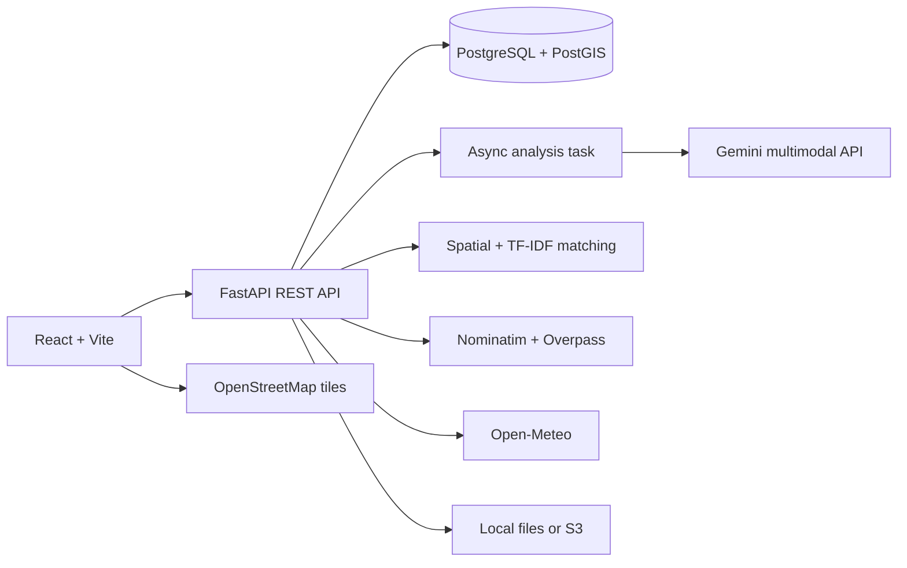

# CivicLens

CivicLens is a civic grievance reporting and intelligence app. Citizens can submit an issue with a description, photo, and map location; the API records it, links similar nearby reports, then asynchronously analyzes and routes it. The public dashboard uses database records only.

## Run on Windows with Docker Desktop

1. Start Docker Desktop and wait for `docker info` to work.
2. From PowerShell in this folder:

   ```powershell
   Copy-Item .env.example .env
   notepad .env
   ```

   Set a unique `JWT_SECRET_KEY` and `ADMIN_EMAIL` / `ADMIN_PASSWORD`. Add `GEMINI_API_KEY` to enable AI. The `.env` file is local and must not be shared or committed.
3. Build and start:

   ```powershell
   docker compose up --build
   ```
4. Open the citizen app at http://localhost:5173 and API docs at http://localhost:8000/docs. Stop with Ctrl+C.

PostGIS is exposed on host port 5434 to avoid conflicts with other local PostgreSQL containers. The local database image restores the official PostgreSQL entrypoint when the cached PostGIS image has a damaged entrypoint. The API uses the Compose network/database internally. Persistent database and upload data use Docker volumes. To remove local records and uploaded images: `docker compose down -v`.

Without a Gemini key, reports remain stored and trackable, but AI analysis reports an explicit configuration error. Reports, analytics, and empty states do not use fabricated records.

## Test and build

```powershell
py -3.12 -m pytest backend/tests -q
Set-Location frontend
npm ci
npm run build
```

## Workflow and integrations

Submissions are stored before background Gemini analysis. The API computes explainable severity from reported safety hazards, road obstruction, visible damage indicators, confidence and, for water/drainage categories, local rainfall. Duplicate matching combines PostGIS proximity (250 m), matching issue category, and TF-IDF cosine similarity. Category routing creates unverified department directory entries when no authority is configured. Administrators can update status and maintain the directory.

OpenStreetMap tiles power interactive maps. Nominatim provides reverse geocoding, Overpass returns nearby mapped roads and amenities, and Open-Meteo provides weather context. Responses cache in-process for one hour; Nominatim calls are rate-limited to one per second. Public APIs have use policies and capacity limits.

Images are validated by content and stored locally by default. Configure AWS S3 bucket and credentials for S3 storage. Configure `GEMINI_API_KEY` and `GEMINI_MODEL` for multimodal analysis.

## API

Interactive request/response documentation is served at `/docs`.

| Method | Path | Purpose |
|---|---|---|
| POST | `/api/grievances` | Submit a multipart issue and optional image |
| GET | `/api/grievances` | List reports; filter by category, severity, status |
| GET | `/api/grievances/{grievance_number}` | Track grievance and status history |
| GET | `/api/dashboard` | Database-backed analytics |
| GET | `/api/map` | Geolocated grievance records |
| GET | `/api/geospatial/reverse` | Nominatim reverse geocoding |
| GET | `/api/geospatial/nearby` | Overpass mapped roads and amenities |
| GET | `/api/weather` | Open-Meteo weather |
| GET | `/api/departments` | Authority directory |
| POST | `/api/auth/login` | Sign in and receive bearer token |
| PATCH | `/api/admin/grievances/{id}/status` | Admin-only status update |
| POST/PATCH | `/api/admin/departments` | Admin-only department management |

## Architecture



Compose is for local development/demo. For production use HTTPS, private database networking, managed secrets, restricted S3 IAM access, backups and log monitoring; move AI processing to a durable worker queue for higher throughput.
